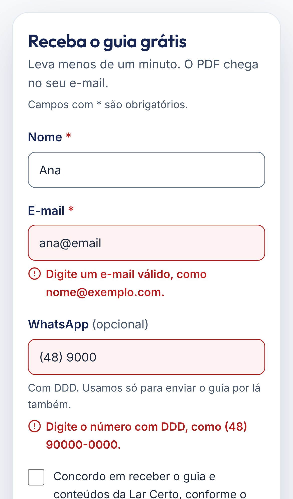
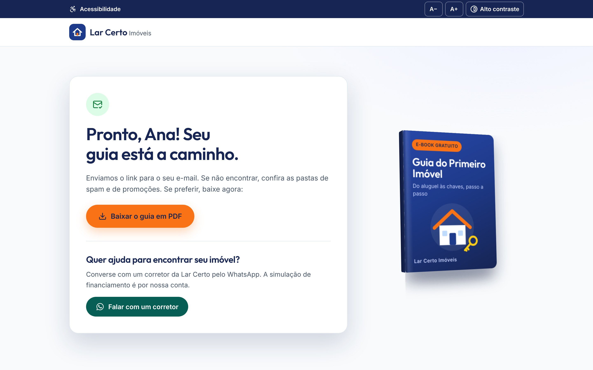

# Guia do Primeiro Imóvel · Landing page de captura em React

> **Projeto conceitual de portfólio.** A Lar Certo Imóveis, as pessoas, os números e os depoimentos são fictícios.

Página de captura de uma imobiliária fictícia da Grande Florianópolis. O visitante deixa nome, e-mail e WhatsApp (opcional) e recebe um e-book gratuito sobre a compra do primeiro imóvel.

**Ver online:** https://gabrielgandra1.github.io/lp-guia-primeiro-imovel/


| Erro de validação no celular | Página de obrigado |
| --- | --- |
|  |  |

## O que a página tem

- Página curta e sem menu: abertura dividida (título, três benefícios e formulário de um lado, capa do e-book em 3D do outro), capítulos do guia, quem preparou, prova social, segundo formulário e rodapé com aviso de privacidade.
- No celular, o formulário aparece logo abaixo do título.
- Formulário como componente React reutilizado nas duas chamadas da página.
- Página de obrigado separada (`/obrigado/`) com o nome da pessoa, botão para baixar o PDF na hora e convite para falar com um corretor pelo WhatsApp.
- E-book de verdade em PDF (8 páginas, com marcação de acessibilidade e fontes embutidas).

## Formulário

- Nome e e-mail obrigatórios, formato de e-mail conferido e máscara de telefone `(48) 90000-0000`.
- Caixa de consentimento da LGPD obrigatória, com link para o aviso de privacidade.
- Mensagens de erro claras embaixo de cada campo, ligadas ao campo por `aria-describedby`, com `aria-invalid` e foco automático no primeiro campo com erro.
- Envio simulado por padrão. Para receber os contatos de verdade, crie um formulário gratuito no [Formspree](https://formspree.io) e defina a variável `VITE_FORMSPREE_ID` antes do build (veja `.env.example`).
- O primeiro nome vai para a página de obrigado pelo `sessionStorage`, nunca pela URL.

## Acessibilidade (WCAG 2.2 nível AA)

- HTML semântico com landmarks, um único `h1` por página e hierarquia de títulos.
- Link "Pular para o conteúdo principal".
- Barra de acessibilidade: aumentar e diminuir o texto (até 137,5%) e alto contraste, com a preferência salva e anunciada ao leitor de tela.
- VLibras (tradução para Libras), carregado na primeira interação para não pesar na abertura.
- Navegação completa por teclado, foco sempre visível e alvos de toque com pelo menos 44 px.
- Contraste mínimo de 4,5:1 nos textos (o botão laranja usa texto azul-marinho, 5,2:1), bordas de campos com 3:1 e suporte a "reduzir movimento" e ao modo de cores forçadas do Windows.
- Sem rolagem horizontal em 320 px, mesmo com o texto no tamanho máximo.

## SEO

- HTML pré-renderizado no build: o conteúdo já chega pronto no HTML, sem depender do JavaScript para aparecer. O React assume a página com `hydrateRoot`.
- Título, descrição, URL canônica, Open Graph e Twitter Card com imagem de 1200 × 630 px.
- Dados estruturados em JSON-LD: `RealEstateAgent`, `Book` (e-book gratuito) e `WebPage`.
- Página de obrigado com `noindex`, `sitemap.xml`, `robots.txt`, favicon (SVG, ICO e PNG), `site.webmanifest` e página 404.

## Resultados medidos

Medição em servidor local (`vite preview`), antes da publicação.

| Ferramenta | Desempenho | Acessibilidade | Boas práticas | SEO |
| --- | --- | --- | --- | --- |
| Lighthouse 13.6, celular | 100 | 100 | 100 | 100 |
| Lighthouse 13.6, computador | 100 | 100 | 100 | 100 |

- axe-core 4.14 (WCAG 2.0, 2.1 e 2.2 A/AA e boas práticas): nenhuma violação nas duas páginas, no computador, no celular e com alto contraste e texto no tamanho máximo.
- Testes automatizados com Vitest para a validação e a máscara de telefone.

## Tecnologias

React 19, Vite 8, Vitest, Lucide (ícones) e CSS puro com variáveis.

## Estrutura

```text
.
├── index.html                página de captura
├── obrigado/index.html       página de obrigado
├── src/
│   ├── components/           formulário, capa 3D, barra de acessibilidade, cabeçalho e rodapé
│   ├── pages/                Home e Obrigado
│   ├── lib/                  validação, máscara, VLibras e configurações
│   ├── styles/global.css
│   ├── main.jsx              hidratação da página de captura
│   ├── obrigado.jsx          hidratação da página de obrigado
│   └── entry-server.jsx      renderização para a pré-renderização
├── scripts/prerender.mjs     injeta o HTML pré-renderizado no build
├── public/                   fontes, ícones, PDF, manifest, robots e sitemap
├── docs/                     build publicado pelo GitHub Pages
└── prints/                   imagens para o portfólio
```

## Rodar localmente

Requer Node.js 20.19 ou mais recente.

```bash
npm install
```

```bash
npm run dev
```

O endereço aparece no terminal (por padrão, `http://localhost:5173/lp-guia-primeiro-imovel/`).

Outros comandos:

```bash
npm test
```

```bash
npm run build
```

```bash
npm run preview
```

O `npm run build` gera a pasta `docs/` já pré-renderizada.

## Publicação no GitHub Pages

Em **Settings → Pages**, escolha **Deploy from a branch**, a branch `main` e a pasta `/docs`. Depois de qualquer mudança, rode `npm run build` e faça o commit da pasta `docs/`.

Se publicar em outro endereço, ajuste o `base` no `vite.config.js` e as URLs absolutas do `index.html`, do `sitemap.xml` e do `robots.txt`.

## Créditos

- Fontes: [Inter](https://rsms.me/inter/) e [Outfit](https://fonts.google.com/specimen/Outfit), licença SIL Open Font License 1.1, obtidas via Fontsource.
- Ícones: [Lucide](https://lucide.dev) (licença ISC) e [Font Awesome Free](https://fontawesome.com) para o ícone do WhatsApp (CC BY 4.0).
- Ilustrações e capa do e-book: criadas para este projeto.

## Licença

Código sob a licença MIT. Veja [LICENSE](LICENSE).
